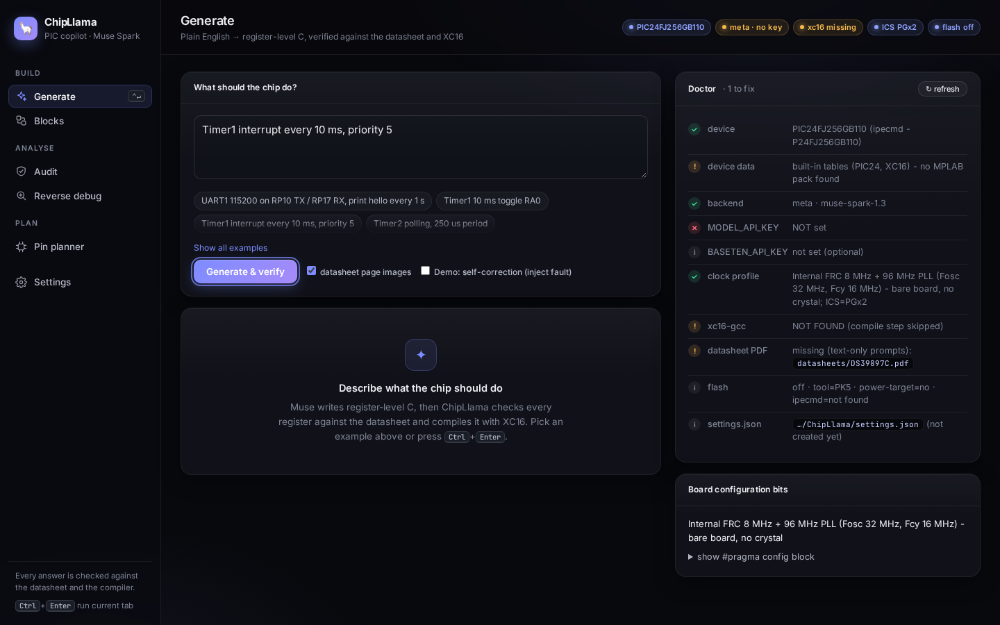
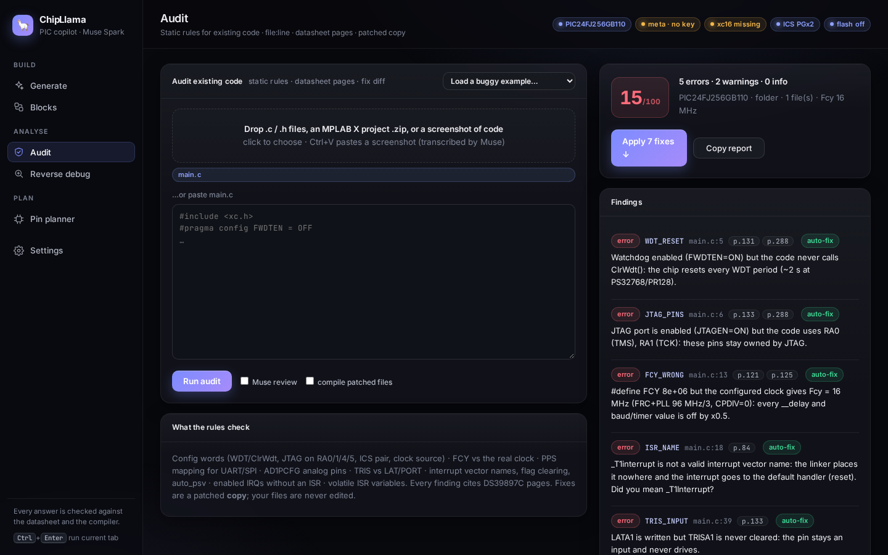
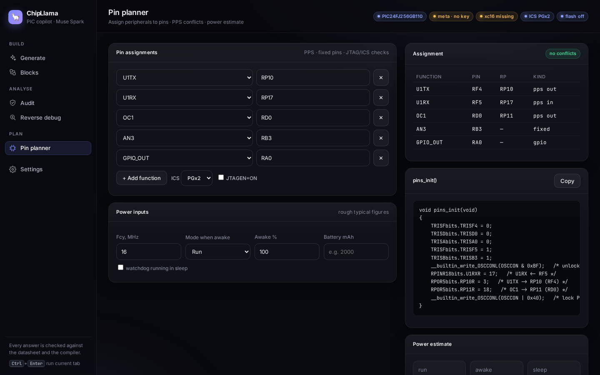
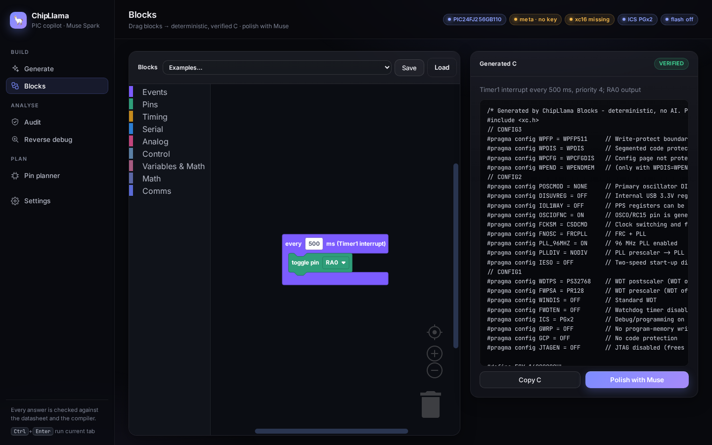
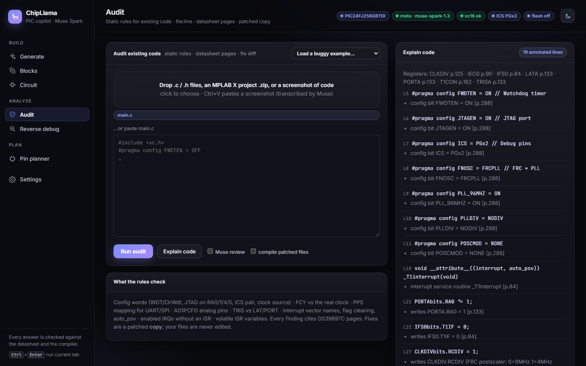

<div align="center">

# ChipLlama 🦙⚡

**The PIC firmware copilot that proves its code is right.**

Plain English in → register-exact, compiler-checked, datasheet-cited C out — for PIC24, dsPIC33, PIC18 and PIC32.
Powered by Meta **Muse Spark** (Meta Model API).

`Python 3.11+` · `Windows / Linux` · `MPLAB XC8 · XC16 · XC-DSC · XC32` · `PICkit 5` · `MIT`




</div>

> Built for the Meta Global AI Developer Hackathon (Oct 27 – Nov 4 2026). See [Built during the hackathon](#built-during-the-hackathon-started-oct-27-2026).

ChipLlama is **not a datasheet chatbot**. A chatbot says "probably this register value". ChipLlama replays the generated init code in a register emulator, compares the result with a deterministic reference solver, compiles it with the real Microchip compiler, and loops with Muse until everything passes. Only then is the code marked **VERIFIED**.

Proven, not promised: **559 tests green**, and Timer1/UART1/SPI1 generation plus SFR screenshot debug **verified live** against the real XC16 toolchain (see [Verified live](#verified-live-nov-1-2026-and-remaining-assumptions)).

## ✨ Features

- **Generate → verify → self-correct.** Request → spec → datasheet pages (as images) → Muse writes C → `xc16-gcc`/`xc-dsc-gcc`/`xc8-cc`/`xc32-gcc` compiles → checker → feedback until both pass.
- **Deterministic peripheral calculators and checkers** (no AI, no key — `chipllama calc`):
  Timers 1–5 (16/32-bit, gated), interrupts and priorities, GPIO/CN/INTx, ADC (scan, auto-trigger),
  Output Compare PWM, Input Capture, UART1–4, SPI1–3, I2C1–3, RTCC, CRC, PMP, Sleep/Idle/Doze/WDT,
  PPS mapping and lock, config bits matched to your board.
- **USB is honestly labelled** *UNSUPPORTED-for-verification* — ChipLlama checks the clock/config and points you to MLA/MCC instead of pretending.
- **Reverse debugging.** Paste a register dump or a screenshot of the MPLAB X SFR window; Muse transcribes it (vision), a rule engine finds *why* the ISR never fires, and Muse explains only the verified findings.
- **Multi-device via MPLAB X packs (EDC).** Any installed PIC: exact `#pragma config` blocks, correct `-mcpu`/`-mprocessor`, automatic `-mdfp` selection (including the XC32 v5 pack layout) with a Doctor warning when a pack is too old.
- **MPLAB X export** (`main.c`, `build.bat`, Makefile) and an **opt-in** PICkit 5 flash step via `ipecmd`.
- **Local dashboard** (FastAPI, no CDN) and a full CLI.

## 🎬 Demo (3 minutes, no API key needed for steps 2-5)

> 🎬 **Demo video:** link added before the Nov 4 submission.

| Generate | Audit | Pin planner |
|---|---|---|
|  |  |  |

| Blocks | Explain code |
|---|---|
|  |  |

1. `chipllama serve` → **Generate**: type *"Timer1 interrupt every 10 ms, priority 5"*, press **Ctrl+Enter**. Muse writes register-level C; every register is checked against DS39897C and compiled with XC16 (needs `MODEL_API_KEY`).
2. **Blocks**: pick an example, drag blocks; the C on the right is deterministic and already verified.
3. **Audit** → *Load a buggy example* → `blinky_buggy`: score 15/100, findings with datasheet pages; **Apply 7 fixes** downloads a patched copy that scores 100.
4. **Explain code** (Audit tab): every register access annotated with decoded fields and its datasheet page. CLI: `chipllama explain main.c`.
5. **Pin planner**: assign `U1TX=RP10`, `OC1=RC1` → instant conflict (*RC1 is RPI38, input-only*), a ready `pins_init()` and a rough power/battery estimate. CLI: `chipllama pins U1TX=RP10 U1RX=RF5`.
6. **Reverse debug**: drop a screenshot of the MPLAB X SFR window; ChipLlama decodes the registers and points at the root cause.

See [ROADMAP.md](ROADMAP.md) for what comes next.

## 🧠 How it works

```mermaid
flowchart LR
    U[Request<br/>"SPI1 2 MHz mode 3"] --> P[Parser + spec<br/>Fcy, pins, rates]
    P --> R[Reference solver<br/>deterministic]
    P --> D[Datasheet pages<br/>PNG + register tables]
    D --> M[Meta Muse Spark<br/>writes C]
    M --> C[XC compiler<br/>-mcpu / -mdfp]
    C -->|errors| M
    C --> E[C-subset register emulator]
    E --> K[Checker vs solver<br/>+ board config rules]
    R --> K
    K -->|findings| M
    K -->|all pass| V[✅ VERIFIED C<br/>+ MPLAB X project]
    V -.opt-in.-> F[PICkit 5 flash]
```

## 🚀 Quick start (Windows, PowerShell)

```powershell
git clone https://github.com/RafaelMarian/ChipLlama ; cd ChipLlama
py -3.11 -m venv .venv
.\.venv\Scripts\Activate.ps1
pip install -e .                       # dev: pip install -r requirements-dev.txt
copy .env.example .env                 # then edit .env – never commit it
.\.venv\Scripts\chipllama.exe doctor   # keys, compilers, packs (DFP), datasheet, ipecmd
.\.venv\Scripts\chipllama.exe serve    # dashboard on http://127.0.0.1:8000
```

Offline, no key needed:

```powershell
chipllama calc "Timer1 every 10 ms"
chipllama calc spi "SPI1 master 2 MHz mode 3"
chipllama calc i2c "I2C1 400 kHz"
chipllama calc power "watchdog 1 s"
```

### What works on a fresh machine (judges, no installs)

- **No API key:** everything deterministic works — `calc`, `audit`, `pins`, `explain`, Blocks C generation, Circuit checks. Only `generate` and Muse explanations need a key.
- **No XC16:** the compile step is skipped gracefully; verification falls back to registers-only.
- **No datasheet PDF:** text-only mode (no page images sent to the model). The register facts stay embedded in `chipdb.py`, so checking still works.
- **No MPLAB X packs:** bundled EDC snapshots for 7 devices (`chipllama/data/edc/`) cover `#pragma config` and project generation; full pack search (`devices` command, `-mdfp` auto-select) needs local packs.
- **Full demo:** API key + XC16 + `datasheets/DS39897C.pdf` + MPLAB X packs. `chipllama doctor` tells you exactly what is missing.

## 🦙 Using Meta Muse

Put your key in `.env` (git-ignored):

```ini
MODEL_API_KEY=...                      # Meta Model API key (dev.meta.ai)
```

```powershell
chipllama generate "Timer1 interrupt every 10 ms, priority 5" --out main.c --export out\proj
chipllama debug --image sfr_screenshot.png --symptom "timer ISR never runs"
```

Muse receives the request, the relevant register tables and the rendered datasheet pages as images; it never sees the reference solution, so the checker is an independent proof, not a string match.

### Compilers

| Family | Compiler | Notes |
|---|---|---|
| PIC10/12/16/18 | XC8 (`xc8-cc`) | `-mdfp=<pack>/xc8`; verified live with XC8 v3.10 on PIC18F45K22 |
| PIC24 | XC16 (`xc16-gcc`) | |
| dsPIC33 | **XC-DSC** (`xc-dsc-gcc`) or XC16 | Settings → *dsPIC compiler* (`auto` prefers XC-DSC); v3.30+ gets `-mdfp=<pack>/xc16` |
| PIC32 | XC32 (`xc32-gcc`) | `-mdfp=<pack root>`; **XC32 v5 needs a pack with `xc32/device_files/`** – Doctor warns and tells you to update the DFP in MPLAB X → Tools → Packs |

Put the datasheet at `datasheets\DS39897C.pdf` (not bundled, Microchip copyright). Without it ChipLlama runs in text-only mode.

## What is verified, and how

| Layer | What it proves | Needs |
|---|---|---|
| Timer calculator (`timers.py`) | Reference prescaler/PR for Timer1/2/3 incl. 32-bit Timer2/3 (PR3=MSW, PR2=LSW), `Fcy = Fosc/2`, period = (PR+1)·prescale/Fcy | nothing |
| C-subset emulator + checker (`cemu.py`, `checker.py`) | Final register values after your init code; TON/TCS/TGATE/T32, period, IE, IP (0 = source disabled), ISR exists with `interrupt` attribute and clears its flag, PR loaded, write-order warnings | nothing |
| `xc16-gcc` compile (`compiler.py`) | Code builds for `-mcpu=24FJ256GB110`; diagnostics are parsed and fed back | XC16 installed (**skipped gracefully if absent**) |
| Optional flash (`flash.py`) | Programs the `.hex` via `ipecmd.exe` + PICkit 5 | MPLAB X IPE, PICkit 5, **off by default** |

Register facts (addresses, bit positions, reset values, page numbers) were extracted from the datasheet **DS39897C** text and are embedded in `chipllama/chipdb.py` with their page numbers (e.g. T1CON 0x0104 p.162, T2CON 0x0110 p.166, T3CON 0x0112 p.167, IFS0 p.84, IEC0 p.90, IPC0/1/2 p.97–99). The datasheet itself is **not bundled** (Microchip copyright) — see below.

## Your board: clock profile, config bits and ICS pins

ChipLlama assumes a **bare self-made board** (just the PIC, no crystal). The default profile is
**`frcpll`: internal FRC 8 MHz -> RCDIV=1 (4 MHz, the reset value) -> 96 MHz PLL -> CPDIV=0 -> Fosc 32 MHz, Fcy 16 MHz**
(DS39897C sect. 8.5.1, CLKDIV register 8-2 p.125, CW2 p.290). Every generated file starts with the full
`#pragma config` block, and the checker fails code that is missing a setting, uses the wrong value, or whose clock
does not match the Fosc used in the timer math.

| profile | clock | Fosc |
|---|---|---|
| `frcpll` (default) | FRC + PLL, PLLDIV=NODIV, RCDIV=1 | 32 MHz |
| `frcpll_div2` | FRC + PLL, PLLDIV=DIV2, needs `CLKDIVbits.RCDIV = 0;` first | 32 MHz |
| `frc` | FRC, PLL off | 8 MHz |
| `xtal` | external crystal + PLL (XT up to 10 MHz, else HS), PLLDIV taken from `crystal_hz` | 32 MHz |

Why NODIV and not DIV2: after reset RCDIV=1, so the PLL already gets 4 MHz. With DIV2 the PLL would get 2 MHz
(out of spec) until the code clears RCDIV.

Default block (ICS = PGx2):
```c
#pragma config WPFP = WPFP511, WPDIS = WPDIS, WPCFG = WPCFGDIS, WPEND = WPENDMEM            // CONFIG3
#pragma config POSCMOD = NONE, DISUVREG = OFF, IOL1WAY = OFF, OSCIOFNC = ON, FCKSM = CSDCMD // CONFIG2
#pragma config FNOSC = FRCPLL, PLL_96MHZ = ON, PLLDIV = NODIV, IESO = OFF
#pragma config WDTPS = PS32768, FWPSA = PR128, WINDIS = OFF, FWDTEN = OFF, ICS = PGx2       // CONFIG1
#pragma config GWRP = OFF, GCP = OFF, JTAGEN = OFF
```
**ICS depends on your wiring**: set it to the PGECx/PGEDx pair your PICkit 5 is connected to
(PGx1/PGx2/PGx3, CW1 p.288). If it's wrong, debugging won't work, though programming usually still does.

Sources for the pragma names: the datasheet gives bit meanings but no XC16 names. The names come from
MPLAB X-generated blocks for the PIC24FJ256GB110 in public forum posts (edaboard, Microchip forum) and from a
p24fj256gb110.h listing. Run `xc16-gcc --help` or check `docs/config_index.html` in your XC16 install to confirm.

## 🧱 MCU families: Arduino AVR, STM32, ESP32

The PIC24FJ256GB110 is still the primary target, and nothing in the PIC path changed. On top of it, M8 adds family plugins in `chipllama/families/`:

| Family | Boards | Mode | Checker | Toolchain |
|---|---|---|---|---|
| Arduino AVR | Uno, Nano (ATmega328P), Mega 2560 | bare-metal C (default) or Arduino sketch | register/bit names checked against the Microchip ATDF | avr-gcc (from the Arduino AVR core) or arduino-cli |
| STM32 | Blue Pill (F103C8), Nucleo-F411RE, F030F4P6 | bare-metal CMSIS | CMSIS macros and instances from the vendor header, F1 CRL/CRH vs MODER/AFR style | arm-none-eabi-gcc |
| ESP32 | DevKitC (ESP32), C3-DevKitM | Arduino (ESP32 core 3.x) | setup/loop, LEDC 3.x API, flash and input-only pins | arduino-cli + esp32 core |

Choose the board under **Settings > Device** and the AVR mode under **Settings > Family mode** (or the Circuit tab mode selector). Family boards are wired into:
- **Generate**: a per-family system prompt, then family checker, then compile on your toolchain, then self-correct.
- **Circuit**: per-pin current limits and ERC, plus HAL, board and drivers project generation. The zip has an `.ino` in Arduino mode.
- **Blocks**: pick a `⬡` example. The blocks drive the parts of a Circuit (LED, button, servo, pot, TMP102, USB-UART) through the HAL/driver API.
- **Audit**: family rules, plus flagging of PIC registers used on a non-PIC board.
- **Doctor**: shows which family toolchains are present. Each missing one is listed with its install command. ChipLlama never installs anything itself.

`examples/circuit/families/` has 48 projects (6 per board) and `examples/blocks/families/` has 24 Blocks programs (3 per board). `python scripts/compile_blocks_examples.py --link` builds them all. Any example whose toolchain is missing is reported as SKIPPED.

Install hints, all optional:
- Arduino CLI: `winget install ArduinoSA.CLI`, then `arduino-cli core install arduino:avr`.
- Arm GNU Toolchain: `winget install Arm.GnuArmEmbeddedToolchain`.
- ESP32 core: add `https://espressif.github.io/arduino-esp32/package_esp32_index.json`, then run `arduino-cli core install esp32:esp32`.

FPGA support is on the roadmap only.

## 🧩 Blocks (visual programming)

The **Blocks** tab is a Blockly editor with PIC24-specific blocks: *Events* (on start, forever, every N ms on Timer1, pin change on CN pins, UART byte received), *Pins*, *Timing*, *Serial*, *Analog*, *Control*, *Variables & Math* and *Comms* (SPI1, I2C1).
The C code is produced by a **deterministic generator** (`chipllama/blocks.py`, no AI). It goes through the same register checker as the Generate tab, and a **VERIFIED** badge is shown when it passes.
You can also:
- **Polish with Muse** sends the verified code to Muse Spark as the starting point, and the result is verified again.
- Save and load workspaces as JSON.
- Open one of five examples in `examples/blocks/`.

Blockly 11.2.2 is vendored in `chipllama/web/vendor/`, so no CDN is needed (Apache-2.0, see `NOTICE.md`).

## 🔍 Audit existing code

Point ChipLlama at code you already have — a single `.c`, a folder, or an MPLAB X `MyProject.X` folder
(the device is read from `nbproject/configurations.xml`) — and get a score, findings with `file:line`
and DS39897C pages, and a patched **copy** of the project. No API key needed; the rules are deterministic.

```powershell
chipllama audit examples\audit\blinky_buggy             # report + diff, exit code 1 if errors
chipllama audit examples\audit\uart_sensor.X --json
chipllama audit MyProject.X --fix fixed_copy           # or --fix fixes.zip (never edits in place)
chipllama audit MyProject.X --explain --compile        # + Muse review, + XC16 compile of the patched files
```

Rules: missing/legacy config words, WDT on without `ClrWdt()`, JTAG on while RA0/RA1/RA4/RA5 are used, ICS pair vs your
board, default clock, `FCY` missing or not matching the real clock, UART/SPI used without PPS mapping, digital reads of
analog pins (AD1PCFGL), LAT writes without TRIS, misspelt ISR names, ISRs that never clear their flag, missing
`auto_psv`, enabled interrupts with no ISR, non-`volatile` ISR variables. In the dashboard's **Audit** tab you can
also drop a project `.zip` or paste a screenshot of code (transcribed by Muse, marked as such).
`examples/audit/` holds two deliberately buggy projects and their `expected.json`; `tests/test_audit.py` checks them.

## Local dashboard

`chipllama serve` starts the server on 127.0.0.1:8000 and opens your browser (`--no-browser` stops it opening).
- **Generate**: request box, then live progress (parsed spec, each attempt with its checker findings, compiler output,
  registers and the diff from the previous attempt), then the final code with Copy / Download / Export MPLAB X
  project / Flash to board. Flashing needs flashing turned on in Settings and a confirm dialog.
- **Reverse debug**: paste a register dump, or drop/paste screenshots of the SFR view.
- **Settings**: device, clock profile, crystal, ICS, backend/model/reasoning effort, max iterations,
  xc16/ipecmd paths (with Auto-detect), programmer, power-target, and a flash on/off switch. A Doctor card shows the same checks as `chipllama doctor`.

Settings are saved to **`settings.json`** in the project folder (or wherever `CHIPLLAMA_SETTINGS` points). That file
overrides `.env` and is gitignored. `.env` is never written. The page only shows whether an API key is set, never
the key itself. Keys you type there are stored in plain text in settings.json on your PC, so keep that file private.

## Photo debugging (multimodal reverse debug)

Show ChipLlama what the real board is doing and it tells you why it differs from what you wanted:

1. **Muse Spark vision** reads a screenshot (MPLAB X SFR/Watch window, register dump, oscilloscope/logic analyzer, serial terminal) into strict JSON with a confidence score; malformed JSON is repaired locally, and the model is re-asked once if needed.
2. **Deterministic decode** (no model): OSCCON/CLKDIV → implied Fcy, TxCON/PRx → timer period, U1MODE/U1BRG → baud (incl. BRGH mismatch), scope period ratio → cause (×2 toggle, ×4 PLL off, ×8 prescaler…), serial garbage ratio.
3. **Muse Spark explanation** grounded in those facts, citing DS39897C pages, plus a unified fix diff against your code.

Dashboard: *Reverse debug* tab → drop/paste an image (or click a demo image), type the intent, optionally paste your C code → **Diagnose**. **Apply fix → regenerate & verify** sends the findings to *Generate* so the fixed firmware is regenerated, compiled and checked.

CLI:
```powershell
.venv\Scripts\chipllama.exe debug --image examples\debug\sfr_timer1_prescaler_bug.png --intent "Timer1 interrupt every 10 ms, toggle RA0"
.venv\Scripts\chipllama.exe debug --image examples\debug\scope_20ms_instead_of_10ms.png --intent "RA0 square wave with 10 ms period (100 Hz)" --code examples\debug\toggle_10ms.c
# offline (no API call): use the saved extraction
.venv\Scripts\chipllama.exe debug --image examples\debug\sfr_pll_off.png --extraction examples\debug\sfr_pll_off.extraction.json --intent "Timer1 interrupt every 10 ms, toggle RA0" --no-model
```
Demo images are synthetic (`scripts/make_debug_examples.py`); `*.expected.txt` hold the offline outputs. Every number in the report is recomputed by ChipLlama - the vision model only transcribes.

## MPLAB X IDE + PICkit 5 + XC16 workflow

ChipLlama does not replace MPLAB X — it feeds it.

1. **Install XC16** (the compiler for 16-bit PICs) and MPLAB X. Typical compiler location: `C:\Program Files\Microchip\xc16\v2.10\bin\xc16-gcc.exe` (your version number will differ). ChipLlama auto-detects `C:\Program Files\Microchip\xc16\*\bin` and `PATH`; to pin one, set `XC16_GCC=C:\Program Files\Microchip\xc16\v2.10\bin\xc16-gcc.exe` in `.env`.
2. **Generate**: `python -m chipllama generate "<request>" --export out\proj` (or the *Export MPLAB X folder* button in the web UI, which downloads a zip). With XC16 installed, `xc16-gcc -mcpu=24FJ256GB110` is run on every attempt.
3. **Open in MPLAB X** — the export contains `main.c`, `build.bat`, a `Makefile` and `OPEN_IN_MPLABX.md`. MPLAB X steps: *File → New Project → Microchip Embedded → Standalone Project → Device `PIC24FJ256GB110` → Tool: **PICkit 5** → Compiler: **XC16** → name it*, then add `main.c` under *Source Files*. Set the configuration bits / oscillator (e.g. via *Window → Target Memory Views → Configuration Bits* or the MCC) so the real Fosc matches what you told ChipLlama. Build and program with MPLAB X as usual.
4. **Optional – let ChipLlama program the chip** with MPLAB IPE's command line tool (below).

### Optional, off-by-default flash step (`ipecmd.exe`)

Disabled unless **both** `CHIPLLAMA_ENABLE_FLASH=1` is set **and** you pass an explicit confirmation (`--yes` on the CLI, `confirm=true` in the API). The UI's flash endpoint returns `disabled` otherwise.

```ini
CHIPLLAMA_ENABLE_FLASH=1
IPECMD_PATH=C:\Program Files\Microchip\MPLABX\v6.20\mplab_platform\mplab_ipe\ipecmd.exe
IPECMD_TOOL=PK5            # PICkit 5 (default)
IPECMD_SERIAL=             # optional, selects one of several tools (-TS<serial>)
IPECMD_POWER_TARGET=0      # 1 = power the target from the PICkit 5 (-W)
```

```powershell
python -m chipllama flash out\proj\main.hex --yes
# runs:  ipecmd.exe -P24FJ256GB110 -TPPK5 -Fout\proj\main.hex -M -Y -OL
```

`generate --flash --yes` links an ELF, converts it with `xc16-bin2hex` and then programs it. **Programming real hardware is your decision**: read the command, check the target supply (`-W`), and expect to power-cycle/verify yourself.

## Model (Meta Model API)

* **Meta Model API.** `https://api.meta.ai/v1`, Bearer `MODEL_API_KEY`. Default model `muse-spark-1.3`. ChipLlama uses the OpenAI-compatible **Chat Completions** endpoint (the docs also list `/responses` and `/messages`). Images go as `{"type":"image_url","image_url":{"url":"data:image/png;base64,…"}}` parts in *user* messages. `reasoning_effort` (default `high`) is sent as a top-level field; reasoning tokens count toward `max_tokens` (`CHIPLLAMA_MAX_TOKENS`, default 16000).
* Retries with back-off on 429/5xx; 4xx errors are surfaced verbatim.

## Project layout

```
chipllama/
  chipdb.py      datasheet-verified register map (fields, reset values, page numbers)
  timers.py      request parser + Timer1/2/3 solver (16/32-bit, Fcy = Fosc/2)
  cemu.py        safe C-subset register emulator (defines, casts, |= &= bit math, REGbits.FIELD)
  checker.py     deterministic checker → findings (with the fix hints fed back to the model)
  compiler.py    xc16-gcc runner + diagnostics parser (skips gracefully)
  datasheet.py   pdftoppm / PyMuPDF page rendering → multimodal inputs
  prompts.py     system + feedback prompts
  agent.py       the verify-and-self-correct loop
  debug.py       dump parser, decoder, rule engine, vision transcription
  flash.py       optional ipecmd/PICkit 5 programming (off by default)
  export.py      MPLAB X-ready folder (main.c, build.bat, Makefile, steps)
  models/        Meta Model API (OpenAI-compatible) client
  blocks.py      Blockly workspace → deterministic C       audit.py   static audit rules + patched copy
  pins.py        pin planner (PPS / fixed pins / JTAG+ICS) explain.py per-line register annotation
  power.py       sleep/idle/doze/WDT + rough current estimate
  server.py      FastAPI app   ·   web/ (index.html, app.css, app.js, blocks.js, audit.js, pins.js, fonts/)   ·   cli.py  CLI
tests/           560+ tests, all model/compiler/flash calls mocked
examples/        timer1_10ms.c, dead_timer_dump.txt
datasheets/      put DS39897C.pdf here (git-ignored)
```

## Tests

```powershell
pip install -r requirements-dev.txt
python -m pytest -q
```

All model, compiler and programmer calls are mocked (scripted model replies, `httpx.MockTransport`, injected runners), so the tests run offline without keys or XC16. They cover the calculator, parser, emulator, every checker rule, the agent loop (first-try pass, self-correction after a checker mismatch, self-correction after compile errors, give-up, graceful skip, no-code retry, spec extraction fallback), the wire format of both backends, the debug engine, the FastAPI endpoints, MPLAB X export, ipecmd command construction and the flash safety gates.

## Limitations (please read)

* The emulator understands **init-style straight-line C**: `#define`s, assignments, `|= &= ^=`, `REGbits.FIELD =`, `_T1IE`-style aliases, casts/suffixes. Control flow is *flattened* (statements in `if`/loops are evaluated as if executed once, in order), so exotic code can be mis-judged. The compile step and your scope/logic analyser remain the final word.
* The checker covers the peripherals listed in Features; USB is config-checked only.
* Default Fosc is assumed to be **32 MHz** if the request doesn't say; ChipLlama cannot see your configuration bits.

## Verified live (Nov 1 2026) and remaining assumptions

Live runs on the author's box (XC16 v2.10, PIC24F-GA-GB DFP 1.11.479, Meta Model API `muse-spark-1.3`):
`generate "Timer1 interrupt every 10 ms, priority 5"` → **VERIFIED (registers+compile) on attempt 1**
(5 datasheet page images attached, full `#pragma config` block, compiled with real `xc16-gcc`),
and a fault-injected run (PR1 halved) → checker caught the −50% period error → **VERIFIED on attempt 2**.
Also verified live: `UART1 115200 baud` (checker caught a real U1BRG off-by-one on attempt 1 → VERIFIED on attempt 2),
`SPI1 master 2 MHz mode 3` (first-try pass), and vision reverse-debug of an SFR screenshot
(2 independent passes agreed, confidence 0.99, prescaler root cause + fix with datasheet pages).
`examples/timer1_10ms.c` also compiles clean with the real toolchain.

Honest remainder:
- XC16 `#pragma config` names come from secondary sources (see above), not the datasheet. `PLL_96MHZ` (with
  underscore) is the GB110 spelling; GB0xx/GB210 parts use `PLL96MHZ`. `PLL_96MHZ = OFF` (the `frc` profile) has been seen only as `PLL_96MHz_OFF`.
  (The emitted block does compile under XC16 v2.10, but Microchip may rename settings between versions.)
- `OSCIOFNC = ON` means RC15 is a normal I/O pin. That is the opposite of the raw datasheet bit, so check it.
- COE/BKBUG/DEBUG are not emitted. FRC accuracy is not crystal-grade (see the datasheet electrical specs), so measured periods drift accordingly.
- None of this has been tested on real hardware: `ipecmd`/PICkit 5 command construction is mock-tested only, no chip has been programmed.

Verified from primary sources: Meta Model API base URL/models/Chat Completions image format/`reasoning_effort` values (dev.meta.ai docs, plus live calls); all register addresses/bits/pages (from DS39897C text, extracted with `pdftotext`); `Fcy = Fosc/2`; period formula.

**Not verified / please check on your side:**

1. **Live coverage is Timer1, UART1, SPI1 and SFR screenshot debug.** The remaining peripherals' generate paths and scope/serial-terminal debug have only mock tests. The XC16 header names they emit (`_T2Interrupt`, `_U1RXInterrupt`, `_T1IE`-style aliases, …) are from general knowledge, not checked against installed headers. The checker's ISR-name rule would give a false negative if your XC16 version differs.
2. **ipecmd flags.** `-P<part>`, `-TP<tool>`, `-F`, `-M`, `-OL`, `-W`, `-TS<serial>` and the `PK5` selector for PICkit 5 were taken from a copy of the `ipecmd -?` help text of MPLAB X v6.15 found in a third-party GitHub gist, **not** from a Microchip page I could open. `-Y` (verify) is the least certain flag. Run `ipecmd.exe -?` on your installation to confirm before enabling flash. Part-name convention `-P24FJ256GB110` (no `PIC` prefix) comes from the same source.
3. **Meta API docs/cookbook pages** beyond the pages cited above were not retrievable (404/empty), so e.g. rate limits, `/responses`-only features and exact error bodies are untested.
4. The default `muse-spark-1.3` and `reasoning_effort=high` reflect the docs at build time (Oct 2026) and may change.

## Built during the hackathon (started Oct 27 2026)

ChipLlama was designed and written from scratch during the Meta Global AI Developer Hackathon; development started on **Oct 27 2026** (submission deadline Nov 4 2026, 9 PM ET). Everything in this repository — the register database, solver, emulator, checker, agent loop, debug engine, model clients, server/UI/CLI and tests — was created during that window (see the [commit history](https://github.com/RafaelMarian/ChipLlama/commits/main)). Third-party material used: Microchip's public datasheet DS39897C (register facts only; not redistributed), Meta Model API docs, and the open-source Python libraries listed in `requirements.txt`.

## 🔒 Security notes

* No API keys are stored in the repo; `.env` is git-ignored and `.env.example` contains only empty placeholders.
* Flashing is opt-in twice (env flag + explicit confirm).
* Uploaded screenshots and dumps go only to the configured model backend.
* **Your API key lives only in `.env` on your own machine.** Never commit it, paste it into issues, or share screenshots of it. If it leaks, revoke it at dev.meta.ai immediately.

## License

[MIT](LICENSE) © 2026 Rafael Marian Vanca. Microchip datasheets, headers and packs are © Microchip Technology and are not redistributed.

## Bundled fonts

`chipllama/web/fonts/` vendors Inter and JetBrains Mono (SIL Open Font License 1.1, see the OFL files there) so the UI works offline.
